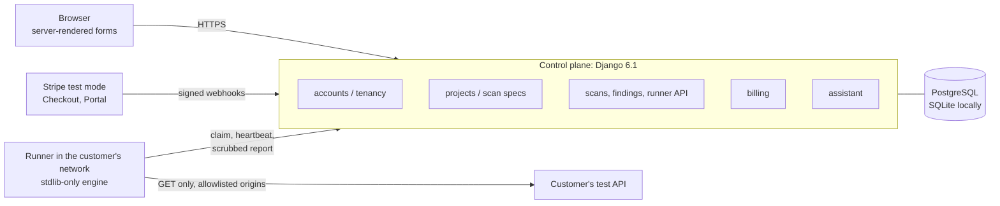

# AccessGuard

**Automated tenant-isolation tests for multi-tenant APIs.** AccessGuard checks whether one
customer of a SaaS product can read another customer's data. You declare test users, the
records they own and who may read what; a runner inside your own environment sends read-only
requests for every combination; a deterministic engine reports a violation only when another
tenant's protected values actually appear in a response. Every finding comes with evidence,
fix guidance and a retest that proves the fix.

> **Status: portfolio project (2026-11-02).** The commercial launch is **paused**. The source
> repository is public; the hosted service has not launched. Nothing is deployed or offered
> for sale, no package has been published, and no live payment has ever been taken. A passing
> AccessGuard report covers only the declared policy and checks; it is not a security guarantee.

**Danish portfolio supplement:** [Portfolio case (in Danish)](docs/portfolio-case.da.md) ·
**Five-minute local demo:** [Demo walkthrough](docs/demo.md)

## The problem

Broken object-level authorisation is ranked first in the OWASP API Security Top 10 (2023):
one missing `WHERE organisation_id = ...` and customer A can read customer B's projects,
invoices or users. These bugs are hard to catch with ordinary tests, because each test usually checks
one user against one endpoint. The number of combinations (users × records × endpoints)
grows quickly, and a fix that blocks *everything* looks like a pass unless legitimate access
is checked too.

## The solution

1. **Declare the policy** in a web app with forms: target URL, allowed path prefixes, how
   test users authenticate (Bearer, API-key header or cookie), test users, records and who
   may read them. Optional import of endpoints from an OpenAPI document.
2. **Approve the exact scope.** The scan spec is frozen with its SHA-256 and the approval is
   recorded with the approver's name.
3. **Scan from inside the customer's network.** A small runner (Python standard library
   only) claims the job, refuses any origin not on its *local* allowlist, reads credentials
   locally, sends GET requests within a budget and deadline, and uploads a report that
   contains no credentials and no response values.
4. **Act on findings.** Evidence, reproduction steps and rule-based fix guidance per
   finding; triage with history; a retest that also re-checks legitimate access, so a
   finding is "resolved and verified" only when the retest conclusively passes.

## Architecture



The control plane never connects to customer systems and never stores their credentials;
only the runner does (pull model, [ADR 0009](docs/adr/0009-local-runner-pull-model.md)).

| Part | Path | What it is |
| --- | --- | --- |
| Engine + runner CLI | `src/accessguard/` | Layered modular monolith, Python ≥ 3.11, no third-party runtime dependencies |
| Web control plane | `web/accessguard_web/` | Django 6.1, server-rendered templates, PostgreSQL in production |
| Demo / integration app | `sampleapp/` | Separate synthetic API with a flawed and a fixed variant and a hand-written answer key |
| ML foundation | `ml/accessguard_ml/` | Labels, versioned datasets, evaluation against baselines, gated model registry |
| Lab and evaluation | `lab/`, `evaluations/` | Vulnerable lab API and the agent-vs-baseline evaluation from milestone 2 |
| Operations | `ops/`, `Dockerfile`, `docker-compose*.yml` | Verify scripts, dev stack, browser and acceptance checks, deployment files, Stripe sandbox drivers |

Full walkthrough: [docs/PROJECT_WALKTHROUGH.md](docs/PROJECT_WALKTHROUGH.md).

## Key technical decisions

| Decision | Why | Trade-off | Record |
| --- | --- | --- | --- |
| Deterministic verdicts: a violation only when another tenant's exact protected values appear | No false positives from status-code guessing; every finding is provable | Transformed or partial leaks are missed; unreadable bodies are INCONCLUSIVE, never PASS | [ADR 0002](docs/adr/0002-explicit-policy-and-verdict-taxonomy.md) |
| Outbound request guard: scope, DNS re-validation, IP pinning, no redirects, link-local/metadata always blocked | The scanner itself must not become an SSRF tool | Slightly more setup (network zones, allowed prefixes) | [ADR 0004](docs/adr/0004-outbound-request-guard.md) |
| Runner in the customer's network (pull model) with a local origin allowlist | Credentials never leave the customer; a compromised control plane cannot redirect scans | Customers must install and run a process | [ADR 0009](docs/adr/0009-local-runner-pull-model.md) |
| Django, server-rendered, instead of an API + SPA | Auth, CSRF, forms, migrations and admin built in; one developer can maintain and test it | Less rich interactivity | [ADR 0010](docs/adr/0010-django-server-rendered-control-plane.md) |
| Stripe webhooks as signals: re-read the subscription under a row lock and mirror Stripe's state | Late, repeated, same-second and concurrent events cannot apply stale state | One Stripe API call per event; 503 (and Stripe's retry) when Stripe is unreachable | [ADR 0011](docs/adr/0011-stripe-billing-and-entitlements.md) |
| Full deterministic coverage instead of AI prioritisation | The milestone 2 evaluation found no demonstrated advantage of a model over simple rules | Scans run every check, so large policies cost more requests | [ADR 0008](docs/adr/0008-selection-strategy-evaluation.md), [evaluation](docs/evaluation.md) |
| AI only as bounded, opt-in assistants; ML only behind an evaluation gate | AI must never decide a verdict, scope or budget | Assistants help with setup and explanations only | [ADR 0012](docs/adr/0012-bounded-ai-assistants.md), [ADR 0013](docs/adr/0013-ml-ranking-foundation.md) |

## What works and how it is verified

"Verified" below means exercised for real (automated tests that were run, or a recorded
run); mocks and fake providers are named as such.

| Capability | Verified by |
| --- | --- |
| Engine: verdicts, coverage, scope and SSRF guard, HTTPS with certificate validation, Bearer / header / cookie auth | Unit, integration (real HTTP and a real local TLS server), security and e2e tests |
| Demo app: the flawed variant yields exactly the 10 answer-key findings; the fixed variant passes all 30 checks | `tests/integration/test_sampleapp_integration.py` against `sampleapp/.../config/answer_key.json` |
| Web control plane: sign-up, organisations, roles, tenant isolation (other tenants' ids answer 404), project setup, approval, live progress, cancel, reports | Django tests incl. two end-to-end journeys over real HTTP with a real runner |
| Findings lifecycle: triage, retest with positive controls, verified resolution, regressions reopen | `FindingsLifecycleTests`; the demo walkthrough below |
| Runner as a customer installs it | Built wheel (CPython 3.12.7) and source archive (3.13.13) installed in clean venvs; `ops/dev/customer_acceptance.py` PASS: scan → triage → fix → retest → 10/10 resolved |
| Billing in Stripe **test mode** | Webhook tests with a `FakeStripe` and the real signature check; plus runs against a real Stripe sandbox (Checkout, Customer Portal, plan changes, failed payments, grace period, cancellation, test-clock renewals and retries, voiding the failed renewal invoice). Concurrency tests run on PostgreSQL in CI |
| Docker compose stack with PostgreSQL 17 | Built and run locally: migrations, readiness, demo runner, scheduled backups, restore into a separate database. **Not run on a server** |
| Browser | Playwright check of the main screens at desktop and phone width; the demo path re-walked in headless Chrome on 2026-11-02 |

**Recorded verification** (2026-11-02; the local run was on `2fefd69`; CI also passed on
the documentation-only commit `36256a5`):

| Where | Result |
| --- | --- |
| Local, Windows 11, `ops/verify.sh` (11 steps: lint, format, mypy strict, engine tests, web tests, migrations, deploy check, pip-audit, secret scan, wheel build, lab demo) | all steps ok; engine/runner/ML 376 tests OK (9 skipped); web tests on SQLite 150 OK (7 skipped) |
| GitHub Actions CI, [run 41464989398](https://github.com/kris7011/accessguard/actions/runs/41464989398) on `36256a5`, six jobs | all passed; engine 376 tests on Ubuntu 3.11/3.13 (2 skipped each) and Windows 3.13 (9 skipped); web 150 tests on PostgreSQL 17 (4 skipped) |

The skipped tests are opt-in by design: paid or free real-model runs, POSIX-only tests on
Windows, and PostgreSQL-only row-lock tests on SQLite. Session-by-session evidence:
[docs/HANDOFF.md](docs/HANDOFF.md); acceptance record: [docs/milestones/V1.md](docs/milestones/V1.md).

## AI and ML: what is actually active

- **Verdicts, scope and budgets are deterministic.** No model decides whether something is
  a violation or whether it is fixed. The product runner always uses the deterministic
  planner.
- **Two AI assistants are implemented** ([ADR 0012](docs/adr/0012-bounded-ai-assistants.md)):
  an OpenAPI setup draft and a finding explainer. Output is schema-validated, labelled as an
  AI draft, opt-in per organisation and applied only after the user reviews it. The provider
  sits behind a port (Anthropic, local Ollama, or `none`, the default). They are covered by
  contract tests with fake providers, and **one opt-in run against the real Claude API
  passed on 2026-10-30** (3 calls, about USD 0.03): both synthetic scenarios were answered,
  validated and recorded, and a deliberately cut-off answer was reported as a failure. That
  run shows the integration works for those scenarios, not general answer quality
  ([docs/ai-live-verification.md](docs/ai-live-verification.md)). The local Ollama provider
  has not been exercised for these tasks.
- **No learning ML model is active.** The ML foundation (consented labels, versioned
  datasets, leave-one-application-out evaluation against baselines, registry with promote
  and rollback) exists and is tested, but the only data is synthetic and the one trained
  candidate was **refused by the promotion gate** (`ml/registry/registry.json`: `"active": null`).
- The milestone 2 adaptive agent (a local model choosing the next check) is kept in the lab
  and evaluation only; its measured advantage was explained by a simple "listings first" rule.

## Run it locally

Requires Python 3.12+ (3.13 used) and Git; no accounts, keys or paid services.

```powershell
py -3.13 -m venv .venv
.\.venv\Scripts\python -m pip install --require-hashes -r requirements-dev.txt
.\.venv\Scripts\python ops\dev\run_stack.py
```

Open <http://127.0.0.1:8000/>, sign up and follow [docs/demo.md](docs/demo.md):
start the demo scan → read the 10 access-control violations → "deploy" the fixed demo app →
retest → all 10 resolved and verified. On Linux/macOS use `.venv/bin/python`.

Run every check:

```bash
PYTHON=.venv/Scripts/python bash ops/verify.sh      # or: powershell ops/verify.ps1
```

Docker and production-like setup: [docs/install.md](docs/install.md).

## Limitations

- **Engine scope:** GET requests only; only declared users, records and endpoints; exact
  JSON value matching; no pagination or query-parameter testing; no write operations, side
  channels or authentication-strength tests.
- **Evidence:** results come from synthetic demo apps and fixtures and say nothing about
  detection rates on real systems.
- **Operations:** never deployed to a server; the production overlay (TLS proxy, off-site
  backups) is prepared and config-checked only. Real e-mail delivery is untested; there is
  no e-mail verification of new accounts; the UI is English only.
- **Payments:** Stripe test mode only. No legal texts, VAT handling or company setup.
- **AI:** assistant quality is unmeasured beyond the one recorded real-model run.
- **Business:** willingness to pay and competitive advantage were never validated; pricing
  and the [economics model](docs/business/economics.md) are hypotheses.

## How this project was built

I defined the product, requirements ([original brief, Danish](AccessGuard-Claude-Code.md)),
milestones and acceptance criteria, and made the owner decisions recorded in the
[handoff log](docs/HANDOFF.md) (for example the rule for voiding a failed renewal invoice and
keeping a 7-day grace period). I ran the paid real-model test myself and claimed and checked
the Stripe sandbox. Claude Code was the AI coding assistant used to write the code, tests and
most documentation under my direction; AI-assisted sessions also ran most verification
commands. The results above are recorded command outcomes, not independent review or a
security guarantee. The [interview preparation notes](docs/interview-prep/V1.md) help me
explain and defend each part.

## Documentation

- Overview: [walkthrough](docs/PROJECT_WALKTHROUGH.md) · [demo](docs/demo.md) · [portfolio case (Danish)](docs/portfolio-case.da.md) · [ADRs](docs/adr/)
- Security: [threat model](docs/threat-model.md) · [report schema](docs/report-schema.md)
- Evidence: [V1 acceptance](docs/milestones/V1.md) · [handoff log](docs/HANDOFF.md) · [AI live run](docs/ai-live-verification.md) · [Stripe sandbox](ops/stripe_sandbox/README.md) · [agent evaluation](docs/evaluation.md)
- Earlier milestones: [M1](docs/milestones/M1.md) · [M2](docs/milestones/M2.md) · interview prep [M1](docs/interview-prep/M1.md), [M2](docs/interview-prep/M2.md), [V1](docs/interview-prep/V1.md)
- Paused commercial material (kept for reference, not active): [install and operations](docs/install.md), [deployment runbook](docs/deployment.md), [launch checklist](docs/launch-checklist.md), [beta operations plan](docs/beta-operations-plan.md), [economics](docs/business/economics.md), [product texts](docs/business/marketing-copy.md)
